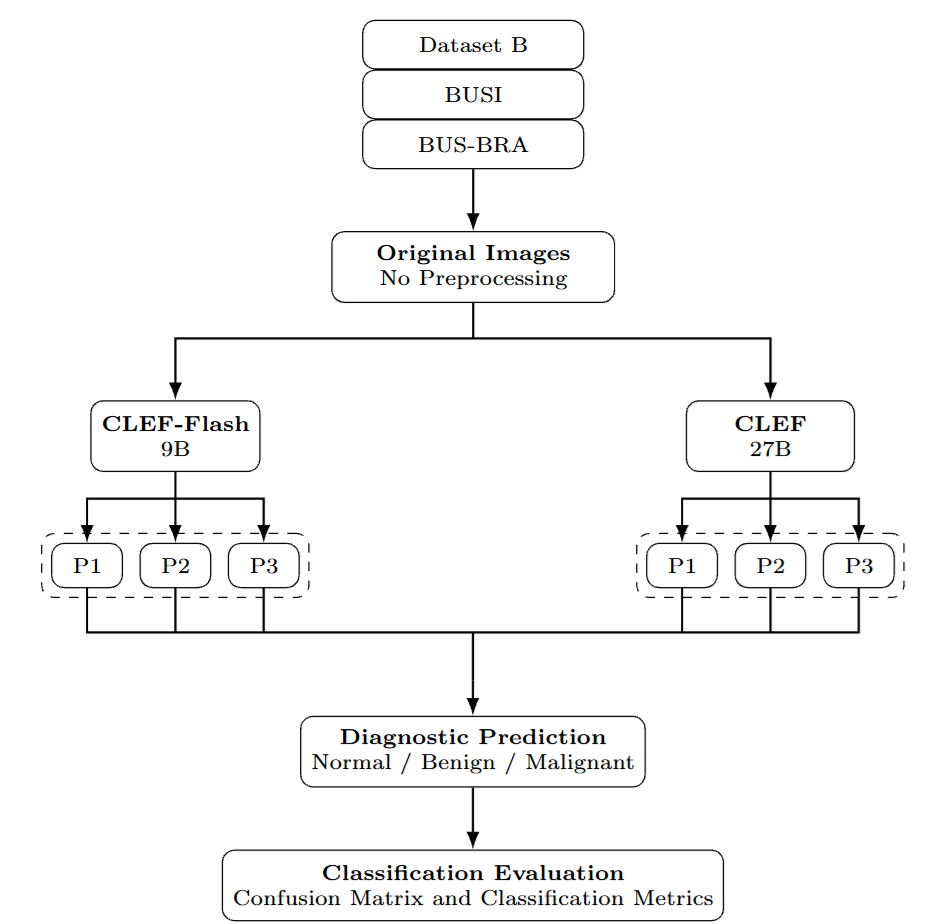

# Can Multimodal Decision Models Classify Breast Ultrasound Images?

[](https://www.python.org/)
[](https://ollama.com/)
[](LICENSE)

Official reproducibility source for the benchmark study:

> **Can Multimodal Decision Models Classify Breast Ultrasound Images? Benchmarking CLEF and CLEF-Flash Across Prompts and Datasets**

## Overview



*Overview of the inference and evaluation pipeline across datasets, models,
and prompting strategies.*

The repository contains the inference and plotting scripts used to evaluate
`clef:latest` and `clef-flash:latest` on three breast-ultrasound datasets under
multiple classification prompts. Dataset files and generated experiment logs
are intentionally excluded from the repository.

## Benchmark Setup

| Dataset | Classes | Input format |
|---|---|---|
| BUSI | `normal`, `benign`, `malignant` | Class directories; `_mask` images are ignored |
| Dataset B | `benign`, `malignant` | Labels from `DatasetB.xlsx` inside `BUS.zip` |
| BUS-BRA | `benign`, `malignant` | Labels from `Pathology` in `bus_data.csv` |

The benchmark reports accuracy, confusion matrices, per-class precision/recall/F1,
and inference latency. The plotting script additionally visualizes the
predicted-class probability and model confidence for every image.

## Models

- `clef:latest`
- `clef-flash:latest`

The model names above are the exact Ollama model tags used by the scripts.

## Installation

Install Ollama and pull both models:

```bash
./setup.sh
```

Create the Python environment for plotting:

```bash
python3 -m venv .venv
source .venv/bin/activate
python3 -m pip install -r requirements.txt
```

Alternatively, use Conda:

```bash
conda create -n clef-eval python=3.10 -y
conda activate clef-eval
python -m pip install -r requirements.txt
```

Ollama must be available at `http://127.0.0.1:11434`.

## Prompts

The prompts are stored in two class-specific variants:

- 3-class BUSI: [`prompts/3class/`](prompts/3class/)
- 2-class Dataset B/BUS-BRA: [`prompts/2class/`](prompts/2class/)

The prompt index is consistent across both variants: `p1`, `p2`, and `p3`.

## Inference

### BUSI

```bash
python3 scripts/eval.py \
  --dataset busi \
  --data /path/to/Dataset_BUSI_with_GT \
  --model clef-flash:latest \
  --prompt "$(cat prompts/3class/p1.txt)" \
  --log logs/busi_clef_flash_p1.csv
```

### Dataset B

```bash
python3 scripts/eval.py \
  --dataset busb \
  --busb-zip /path/to/BUS.zip \
  --model clef:latest \
  --prompt "$(cat prompts/2class/p1.txt)" \
  --log logs/dataset_b_clef_p1.csv
```

### BUS-BRA

```bash
python3 scripts/eval.py \
  --dataset busbra \
  --busbra-zip /path/to/BUSBRA.zip \
  --model clef:latest \
  --prompt "$(cat prompts/2class/p1.txt)" \
  --log logs/bus_bra_clef_p1.csv
```

Resume an interrupted run without repeating images already present in the log:

```bash
python3 scripts/eval.py \
  --dataset busbra \
  --busbra-zip /path/to/BUSBRA.zip \
  --model clef:latest \
  --prompt "$(cat prompts/2class/p1.txt)" \
  --log logs/bus_bra_clef_p1.csv \
  --resume
```

Run the command once per model and prompt. The CSV log stores the image path,
ground-truth label, prediction, latency, raw model response, probabilities,
and confidence.

## Plotting

After producing six logs for a dataset, generate a 2x3 confusion-matrix figure
and a probability/confidence line plot:

```bash
python3 scripts/plot_metrics.py --dataset busi --out-dir plots/busi
python3 scripts/plot_metrics.py --dataset busb --out-dir plots/dataset_b
python3 scripts/plot_metrics.py --dataset busbra --out-dir plots/bus_bra
```

The plots are written to the selected output directory. The `--dataset`
values are implementation identifiers; the figures use the paper-facing names
`BUSI`, `Dataset B`, and `BUS-BRA`.

## Repository Layout

```text
public_git/
├── prompts/
│   ├── 2class/
│   │   ├── p1.txt
│   │   ├── p2.txt
│   │   └── p3.txt
│   └── 3class/
│       ├── p1.txt
│       ├── p2.txt
│       └── p3.txt
├── figs/
│   ├── Overview.png
│   └── caption.md
├── scripts/
│   ├── eval.py
│   └── plot_metrics.py
├── requirements.txt
├── setup.sh
└── LICENSE
```

## Citation

If this repository contributes to your research, please consider citing the
paper:

```bibtex
@article{minh2026clefbenchmark,
  title={Can Multimodal Decision Models Classify Breast Ultrasound Images? Benchmarking CLEF and CLEF-Flash Across Prompts and Datasets},
  author={Cao Minh, Tran and Tran, Hai and Tan, Ha Minh},
  journal={arXiv preprint arXiv:0000.12345},
  year={2026}
}
```

## License

This project is released under the MIT License. See [LICENSE](LICENSE).
